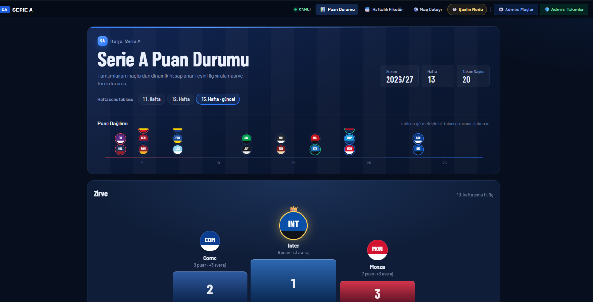
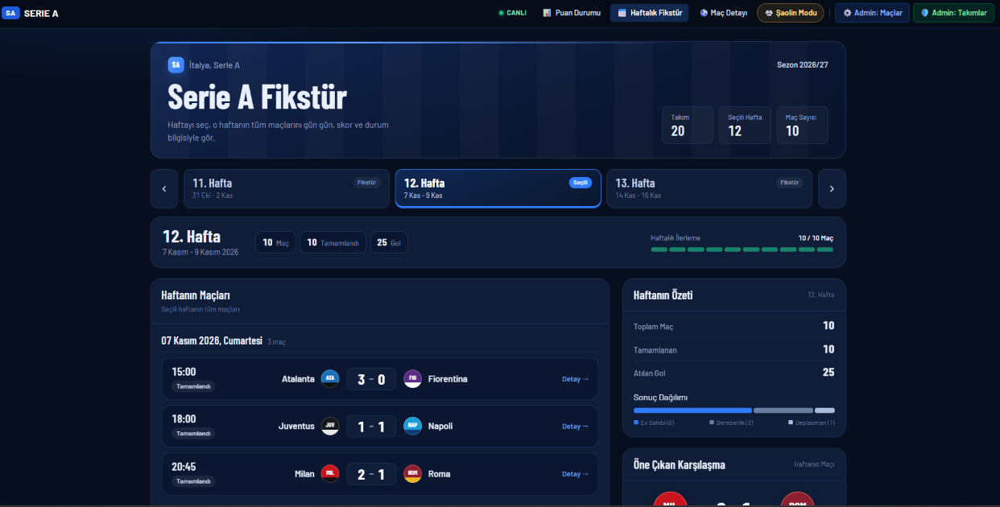
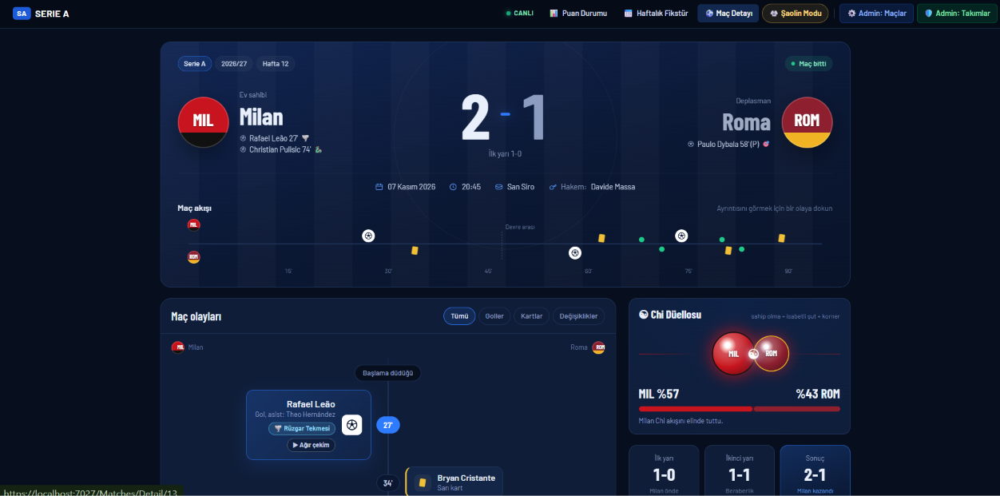
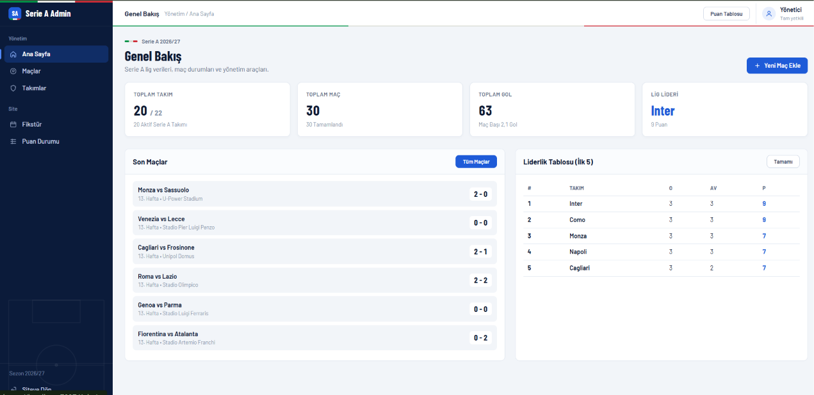
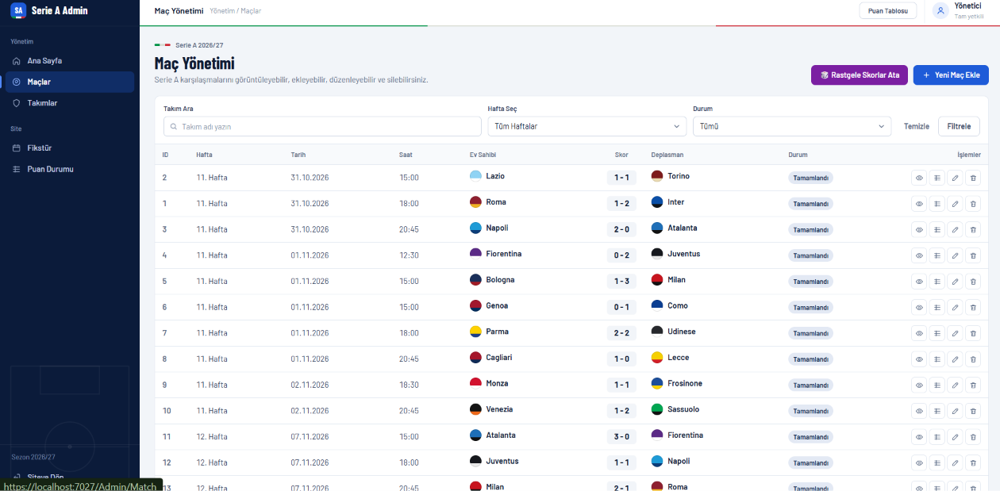
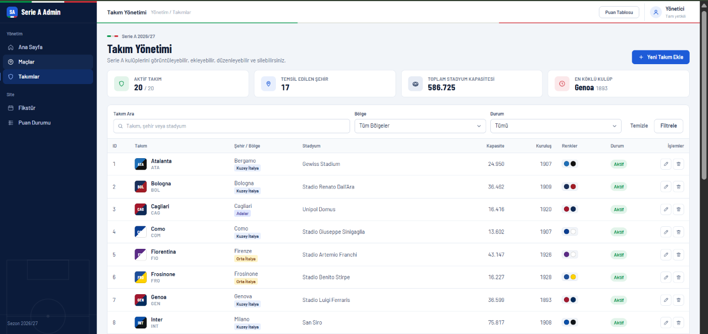
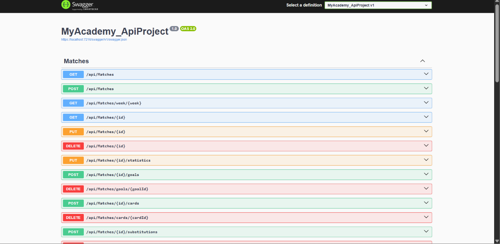

# Serie A Futbol Uygulaması

M&Y Yazılım Eğitim Akademi bootcamp case çalışması: İtalya Serie A ligi için **ASP.NET Core Web API + MVC** uygulaması.
WebUI veritabanına doğrudan erişmez; tüm veriler API üzerinden tüketilir. Puan durumu tamamlanan maçların skorlarından dinamik hesaplanır (ayrı bir standings tablosu yoktur).

## Ekran görüntüleri

| Puan Durumu | Haftalık Fikstür |
|---|---|
|  |  |

| Maç Detayı | Admin - Genel Bakış |
|---|---|
|  |  |

| Admin - Maç Yönetimi | Admin - Takım Yönetimi |
|---|---|
|  |  |

| Swagger |
|---|
|  |

## Öne çıkan ekler

- **Canlı skor (SignalR):** API'deki `/hubs/match` kanalı her maç değişikliğini yayınlar. Admin panelinden (ya da Swagger'dan) skor girildiği an açık olan tüm puan durumu, fikstür, maç ve kulüp sayfaları **yenilenmeden** güncellenir; skor artınca gol animasyonu oynar. Menüdeki `● CANLI` rozeti bağlantı durumunu gösterir.
- **🥋 Şaolin Modu:** *Shaolin Soccer* filminden esinlenen, menüden açılıp kapatılan tema (tercih tarayıcıda saklanır; varsayılan tasarım değişmez). Kırmızı-altın renkler, ateş topu gol animasyonu, kung-fu ünvanları (Büyük Usta, Altın Bacak, Demir Gömlek), puan bölgeleri için kuşak renkleri, maç detayında **Chi göstergesi** (topa sahip olma + isabetli şut + korner), her sayfada "Usta der ki" sözü. Filmden görsel/ses kullanılmadı; hepsi CSS + SVG ile çizildi.
- **Sahne şovları ve efektler:** maç detayına girişte *Maç Sahnesi* (takım renkleri çarpışır, armalar ortada buluşur, skor yuvarlanır, derbiyse derbi adı), canlı golde *Gol Sahnesi* (takım renginde şeritler, dev "GOL!", konfeti), puan durumunda *Kürsü* (ilk 3 spot ışıkları altında yükselir, liderde konfeti), Şaolin Modu açılışında mürekkep fırça geçişi. Ayrıca kaydırınca beliren kartlar, sayarak gelen sayılar, kartlarda 3B eğim ve sayfa geçiş animasyonu. Sahneler "Geç", tıklama veya Esc ile atlanır; "hareketi azalt" tercihi olan kullanıcılarda kapalıdır.
- **Kung-fu gol hareketleri:** her gol kendine özgü bir hareketle anılır (🐉 Ejder Vuruşu, 🦅 Kartal Pençesi, 🌪️ Rüzgar Tekmesi, 🐯 Kaplan Sıçrayışı, 🐍 Kobra Dokunuşu, 🕊️ Turna Kanadı, 🛡️ Demir Kafa, 🌑 Gölge Ayak; penaltı 🎯 Sessiz Ok, kendi kalesine ↩️ Ters Akım). Hareket gol Id'sinden hesaplanır, her yerde aynıdır (`ViewModels/KungFuMoves.cs`).
- **Ağır çekim gol tekrarı:** maç detayında bir gole (veya maç akışındaki gol işaretine) tıklayınca sahada topun ateşli yolu ağır çekimde çizilir; asist pası, vuruş anı, filelerin sallanması ve hareketin adı.
- **Chi Düellosu:** maç detayında iki takımın Chi küreleri (takım renklerinde) ekrana girince ortada, Chi oranının bölündüğü noktada çarpışır; üstün olan küre rakibini geri iter.
- **Haftalık puan durumu:** `/Standings?week=11` ile istenen hafta sonundaki tablo, önceki haftaya göre ▲/▼ sıra değişimi ve takımların hafta hafta sırasını gösteren *Sıralama Yolculuğu* grafiği (en fazla 3 takım karşılaştırılır).
- **Kulüp sayfaları:** `/Teams/Detail/{id}` (puan tablosundaki takım adına tıklayın): sıra, puan, averaj, sezon istatistikleri, son maç formu, golcüler, sıradaki ve oynanan maçlar.
- **Derbi rozetleri:** Derby della Madonnina, della Capitale, d'Italia, della Mole vb. fikstür kartlarında ve maç detayında işaretlenir.
- **Maç istatistikleri:** topa sahip olma, şut, isabetli şut, korner, faul, ofsayt; admin panelinden düzenlenebilir.
- **API kapalı uyarısı:** WebUI, API'ye ulaşamazsa sayfanın üstünde kırmızı bir uyarı bandı gösterir.

## Solution yapısı

```
MyAcademy_ApiProject.sln
├── MyAcademy_ApiProject        → Web API (EF Core + SQL Server)
│   ├── Controllers             MatchesController, StandingsController, TeamsController
│   ├── Entities                Team, Match, MatchGoal, MatchCard, MatchSubstitution, MatchStatistic
│   ├── Hubs                    MatchHub (SignalR canlı skor)
│   ├── Context                 ApiContext, ApiContextSeed + MatchDataGenerator (örnek veri)
│   ├── Dtos                    MatchDtos/, TeamDtos/, StandingDtos/
│   └── Migrations              InitialCreate
└── MyAcademy_ApiWebUIProject   → MVC arayüz (API'yi HttpClient ile tüketir)
    ├── Controllers             Standings, Fixtures, Matches, Teams (kullanıcı ekranları)
    ├── wwwroot/js              live.js (SignalR istemcisi), shaolin.js (Şaolin Modu), sayfa scriptleri
    ├── Areas/Admin             Dashboard, Match, Team (sidebar'lı Türkçe admin paneli)
    ├── Services                IApiService / ApiService
    ├── ViewModels              sayfa modelleri + Admin/ form modelleri
    └── Views/*/Partials        sayfa parçaları (_MatchHeroPartial, _FixtureCardPartial ...)
```

## Çalıştırma

1. SQL Server'ın `localhost` üzerinde Windows Authentication ile erişilebilir olduğundan emin olun.
   Bağlantı: `MyAcademy_ApiProject/appsettings.json` → `ConnectionStrings:DefaultConnection` (veritabanı: **SerieADb**).
2. Önce API'yi başlatın. İlk açılışta migration uygulanır, veritabanı oluşturulur ve örnek veri yüklenir.
   ```bash
   dotnet run --project MyAcademy_ApiProject --launch-profile http
   ```
   API: http://localhost:5279 · Swagger: http://localhost:5279/swagger
3. Sonra WebUI'ı başlatın (API adresi `MyAcademy_ApiWebUIProject/appsettings.json` → `ApiSettings:BaseUrl`).
   ```bash
   dotnet run --project MyAcademy_ApiWebUIProject --launch-profile http
   ```
   WebUI: http://localhost:5257

Visual Studio'da solution'a sağ tıklayıp **Configure Startup Projects → Multiple startup projects** ile ikisini birlikte başlatabilirsiniz.

## Ekranlar

| Ekran | Adres |
|---|---|
| Puan Durumu | `/Standings` |
| Haftalık Fikstür | `/Fixtures?week=12` |
| Maç Detayı | `/Matches/Detail/{id}` (oynanmış 20 maçın hepsinde gol, kart ve istatistik var; 1, 11, 13'te oyuncu değişiklikleri de) |
| Kulüp sayfası | `/Teams/Detail/{id}` |
| Admin - Genel Bakış | `/Admin` |
| Admin - Maç Yönetimi (listele / ekle / düzenle / sil / istatistik) | `/Admin/Match` |
| Admin - Takım Yönetimi | `/Admin/Team` |

## API endpointleri

| Metot | Endpoint | Açıklama |
|---|---|---|
| GET | `/api/standings` | Dinamik puan durumu |
| GET | `/api/standings/summary` | Puan durumu + lig özeti |
| GET | `/api/matches?week=&team=&status=` | Maç listesi (filtreli) |
| GET | `/api/matches/week/{week}` | Haftanın maçları |
| GET | `/api/matches/{id}` | Maç detayı: goller, kartlar, değişiklikler, istatistik |
| POST / PUT / DELETE | `/api/matches`, `/api/matches/{id}` | Maç CRUD |
| PUT | `/api/matches/{id}/statistics` | Maç istatistiklerini kaydet |
| POST / DELETE | `/api/matches/{id}/goals`, `/api/matches/goals/{goalId}` | Gol ekle / sil |
| POST / DELETE | `/api/matches/{id}/cards`, `/api/matches/cards/{cardId}` | Kart ekle / sil |
| POST / DELETE | `/api/matches/{id}/substitutions`, `/api/matches/substitutions/{subId}` | Oyuncu değişikliği ekle / sil |
| GET / POST / PUT / DELETE | `/api/teams`, `/api/teams/{id}` | Takım CRUD (maç geçmişi olan takım silinmez, pasife alınır) |
| POST | `/api/matches/randomize-scores?week=` | Oynanmamış maçlara rastgele skor + uyumlu gol/kart/istatistik |
| SignalR | `/hubs/match` | Canlı yayın: `MatchChanged`, `GoalScored` olayları |

### Canlı skoru denemek
1. Puan durumu veya fikstürü bir sekmede açık bırakın (menüde `● CANLI` yeşil olmalı).
2. Başka sekmede **Admin → Maçlar → Düzenle** ile bir maçın skorunu artırıp kaydedin.
3. İlk sekmede gol animasyonu oynar ve tablo kendiliğinden güncellenir. Şaolin Modu açıksa gol ateş topuyla gelir.

## İş kuralları

- Galibiyet 3, beraberlik 1, mağlubiyet 0 puan. Sıralama: **puan → averaj → atılan gol**.
- Puan durumuna yalnızca **Tamamlandı** (`Finished`) maçlar dahil edilir. Averaj = atılan gol − yenilen gol.
- Bir maçta ev sahibi ve deplasman takımı aynı olamaz.
- Bir takım aynı hafta içinde birden fazla maçta yer alamaz.
- Canlı / Tamamlandı maçlarda iki skor da zorunludur; Başlamadı / Ertelendi maçlara skor kaydedilmez.
- Gol, kart ve değişiklik kayıtları geçerli bir maça ve o maçın takımlarından birine bağlı olmalıdır; dakika 1–120 arası.
- İstatistik: topa sahip olma toplamı 100, isabetli şut ≥ gol ve ≤ toplam şut.
- Bulunamayan kayıtlar için `404`, kural ihlallerinde Türkçe mesajlı `400` döner.

## Örnek veri

20 aktif Serie A takımı (+2 pasif), 11–13. haftalar (her hafta 10 maç, toplam 30 maç).
11 ve 12. haftalar tamamlandı, 13. hafta oynanmadı (1 maç ertelendi). Ekran görüntüleri 13. haftanın skorları da girildikten sonra alındığı için orada 30 maçın tamamı tamamlanmış görünür. Oynanan her maçın skorla birebir uyumlu
gol kayıtları, kartları ve istatistiği vardır (`Context/MatchDataGenerator.cs`, gerçek kadrolardan oyuncu isimleriyle);
1, 11 ve 13 numaralı maçlarda oyuncu değişiklikleri de eksiksizdir. API her açılışta oynanmış ama detayı eksik
maçları tamamlar, elle girilmiş kayıtlara dokunmaz.
Veriler gerçek sezonla birebir aynı değildir, mantıklı ve tutarlıdır (case notu).
